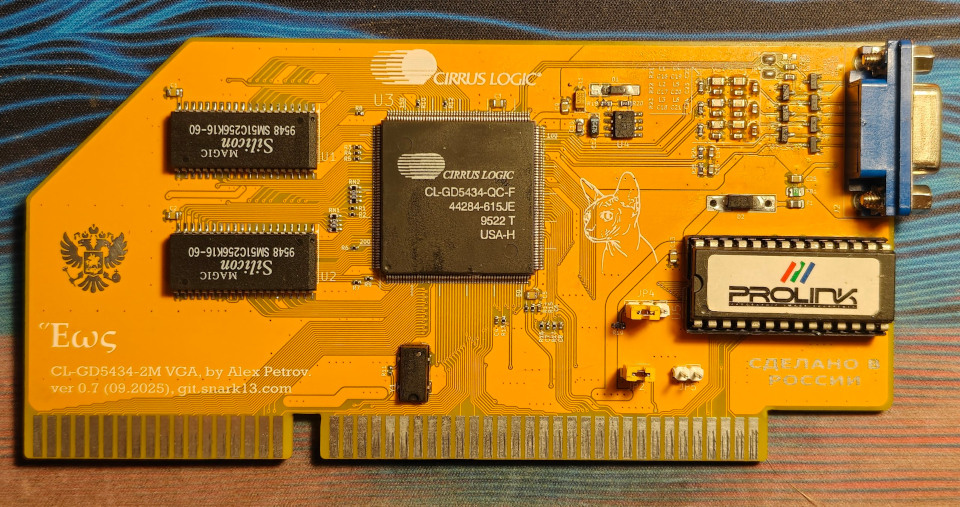
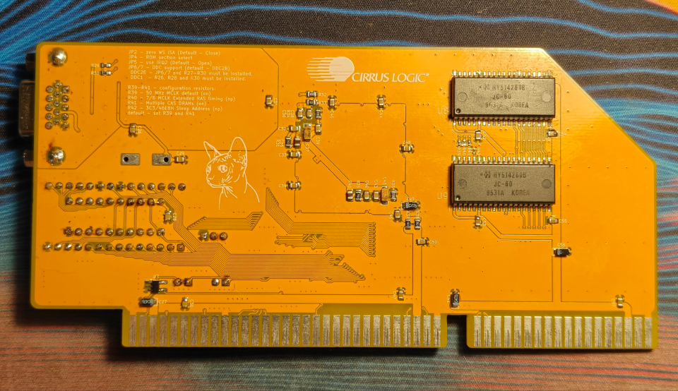

# Eos VGA Card

[Русская версия](README_RU.md)

Main project repository: [git.snark13.com/snark13/eos](https://git.snark13.com/snark13/eos.git).

GitHub mirror: [github.com/snark013/vga-clgd5434-eos](https://github.com/snark013/vga-clgd5434-eos).

Eos is a VGA graphics card for the 16-bit ISA bus, based on the Cirrus Logic CL-GD5434. The project is designed in KiCad and uses a two-layer PCB.

## Project status

Version 0.7 has been assembled and tested with both 1 MB and 2 MB of video memory.

Release files for version 1.0.2 are available in the repository. This version corrects a device type label in the schematic; the PCB is unchanged. The test results above apply to version 0.7.

## Key features

- VGA compatibility.
- Fast video memory access in MS-DOS.
- Hardware graphics acceleration in Microsoft Windows.
- Integrated video digital-to-analog converter (RAMDAC) with True Color support.
- Two video memory configurations: 1 MB or 2 MB.
- Two-layer PCB for the 16-bit ISA bus.

## Video memory configurations

| Capacity | Chips to populate | Status |
| --- | --- | --- |
| 1 MB | U1, U2 | Tested on the version 0.7 board. |
| 2 MB | U1, U2, U8, U9 | Tested on the version 0.7 board. |

## Project files

- [eos.kicad_pro](eos.kicad_pro) — KiCad project.
- [eos.kicad_sch](eos.kicad_sch) — schematic.
- [eos.kicad_pcb](eos.kicad_pcb) — PCB layout.
- [eos.pretty/](eos.pretty/) — local footprint library.
- [docs/](docs/) — reference documentation.
- [release/](release/) — release files: Gerber files, PDF schematics, and interactive bills of materials.
- [images/0.7/](images/0.7/) — photos of the assembled version 0.7 board.

### Release files

| Version | Gerber files | Schematic | Interactive bill of materials |
| --- | --- | --- | --- |
| 1.0.2 | [ZIP](release/1.0.2/eos-1.0.zip) | [PDF](release/1.0.2/eos.pdf) | [HTML](release/1.0.2/ibom.html) |
| 0.7 | [ZIP](release/0.7/eos.zip) | [PDF](release/0.7/eos.pdf) | [HTML](release/0.7/ibom.html) |

## Configuration and assembly

Check the configuration input settings against the [CL-GD543x/4x Technical Reference Manual](docs/Alpine_VGA_Family_CL-GD543X_4X_Technical_Reference_Manual_4ed_Feb95.pdf).

### Configuration resistors

| Reference | Function |
| --- | --- |
| R39 | DRAM clock selection (50 MHz by default) |
| R40 | Extended RAS timing: 7/6 MCLK |
| R41 | DRAM multi CAS/WE configuration |
| R42 | Sleep control port selection: 3C3h / 4E68h |

Of the resistors listed above, R40 and R42 are fitted by default; R39 and R41 are not fitted.

### Configuration jumpers

| Reference | Function |
| --- | --- |
| JP2 | Zero-wait-state ISA operation |
| JP4 | BIOS ROM section selection |
| JP5 | Enable IRQ2 |
| JP6, JP7 | DDC configuration |

JP2 is fitted by default, and the DDC2B configuration is used.

### DDC support

- DDC2B: fit JP6, JP7, and R27–R30.
- DDC1: fit R26, R28, and R30.

### Clock source

Two options are provided for the 14.318 MHz clock:

- ISA bus BOSC signal: fit R11.
- On-board oscillator: fit Y1.

## BIOS

The assembled board uses a BIOS ROM chip from a PCI graphics card based on the CL-GD5434. This BIOS also works with the ISA board.

Unlike BIOS images for earlier Cirrus Logic graphics chips, the CL-GD543x family BIOS already uses linear (“flat”) addressing. The address conversion described for Helios is not required. Compatibility with other BIOS images must be verified separately.

## Revision history

### 1.0.2

- Corrected the mislabeled U6 device type from 74LS541 to 74LS245.
- The PCB is unchanged.

### 0.7

- Changed all capacitors below 0.1 µF to the 0603 package size.
- Added an alternative 5032 footprint for the 14.318 MHz oscillator.
- Built the first working board version.

### 0.5

- Added support for an on-board 14.318 MHz oscillator in a 7050 package.
- Optimized component placement.
- Renumbered components.

### 0.3

- Initial project version.

## Photos

Assembled version 0.7 board.

## Related projects

- [Pine CL-GD5434](https://github.com/Leshak-pcb/Pine-CL-GD5434) — a graphics card based on the same chip, using a four-layer PCB.
