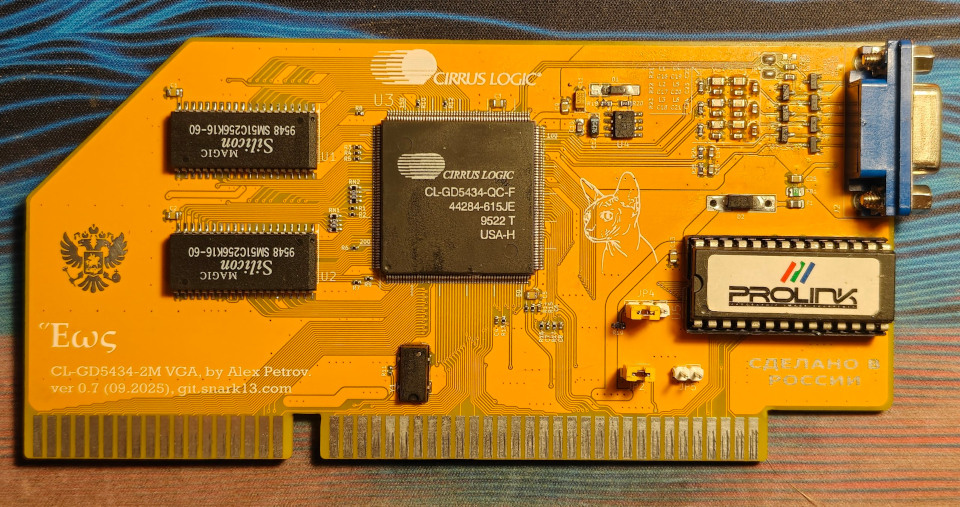
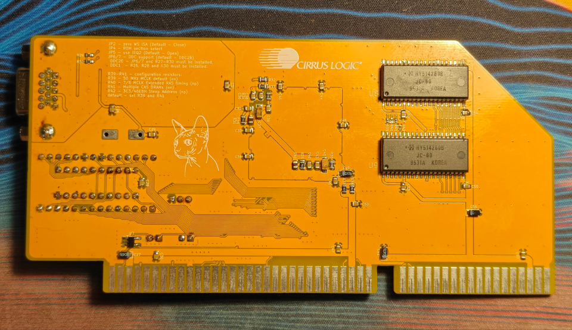

# Eos — видеокарта ISA VGA

[English version](README.md)

Основной репозиторий проекта: [git.snark13.com/snark13/eos](https://git.snark13.com/snark13/eos.git).

Зеркало на GitHub: [github.com/snark013/vga-clgd5434-eos](https://github.com/snark013/vga-clgd5434-eos).

Eos — видеокарта для 16-разрядной шины ISA на базе Cirrus Logic CL-GD5434. Проект выполнен в KiCad и использует двухслойную печатную плату.

## Состояние проекта

Версия 0.7 собрана и протестирована с 1 и 2 МБ видеопамяти.

Материалы выпуска 1.0.2 доступны в репозитории. В этой версии исправлено обозначение типа микросхемы в схеме; печатная плата не менялась. Сведения об испытаниях выше относятся к версии 0.7.

## Основные характеристики

- Совместимость с VGA.
- Высокая скорость работы с видеопамятью в MS-DOS.
- Аппаратное ускорение графики в Microsoft Windows.
- Встроенный в видеочип цифро-аналоговый преобразователь видеосигнала (RAMDAC) с поддержкой True Color.
- Две конфигурации видеопамяти: 1 или 2 МБ.
- Двухслойная печатная плата для 16-разрядной шины ISA.

## Конфигурации видеопамяти

| Объём | Устанавливаемые микросхемы | Состояние |
| --- | --- | --- |
| 1 МБ | U1, U2 | Проверена на плате версии 0.7. |
| 2 МБ | U1, U2, U8, U9 | Проверена на плате версии 0.7. |

## Файлы проекта

- [eos.kicad_pro](eos.kicad_pro) — проект KiCad.
- [eos.kicad_sch](eos.kicad_sch) — принципиальная схема.
- [eos.kicad_pcb](eos.kicad_pcb) — печатная плата.
- [eos.pretty/](eos.pretty/) — локальная библиотека посадочных мест.
- [docs/](docs/) — справочная документация.
- [release/](release/) — материалы выпусков: Gerber-файлы, схема в PDF и интерактивный список компонентов.
- [images/0.7/](images/0.7/) — фотографии собранной платы версии 0.7.

### Материалы выпусков

| Версия | Gerber-файлы | Схема | Интерактивный список компонентов |
| --- | --- | --- | --- |
| 1.0.2 | [ZIP](release/1.0.2/eos-1.0.zip) | [PDF](release/1.0.2/eos.pdf) | [HTML](release/1.0.2/ibom.html) |
| 0.7 | [ZIP](release/0.7/eos.zip) | [PDF](release/0.7/eos.pdf) | [HTML](release/0.7/ibom.html) |

## Конфигурация и сборка

Параметры конфигурационных входов следует сверять с [техническим руководством CL-GD543x/4x](docs/Alpine_VGA_Family_CL-GD543X_4X_Technical_Reference_Manual_4ed_Feb95.pdf).

### Конфигурационные резисторы

| Обозначение | Назначение |
| --- | --- |
| R39 | Выбор частоты DRAM (по умолчанию 50 МГц) |
| R40 | Увеличенная длительность RAS: 7/6 MCLK |
| R41 | Настройка режима DRAM multi CAS/WE |
| R42 | Выбор порта управления режимом сна: 3C3h / 4E68h |

По умолчанию из перечисленных резисторов устанавливаются R40 и R42; R39 и R41 не устанавливаются.

### Конфигурационные перемычки

| Обозначение | Назначение |
| --- | --- |
| JP2 | Работа с ISA без тактов ожидания |
| JP4 | Выбор области ПЗУ BIOS |
| JP5 | Использование IRQ2 |
| JP6, JP7 | Настройка DDC |

По умолчанию устанавливается перемычка JP2 и используется конфигурация DDC2B.

### Поддержка DDC

- DDC2B: устанавливаются JP6, JP7 и R27–R30.
- DDC1: устанавливаются R26, R28 и R30.

### Источник тактового сигнала

Предусмотрены два варианта получения частоты 14,318 МГц:

- Сигнал BOSC с шины ISA: устанавливается R11.
- Собственный генератор на плате: устанавливается Y1.

## BIOS

В собранной плате использована микросхема BIOS от PCI-видеокарты на базе CL-GD5434. Этот BIOS работает и с ISA-вариантом платы.

В отличие от BIOS для более ранних видеочипов Cirrus Logic, BIOS семейства CL-GD543x уже использует линейную («плоскую») адресацию. Преобразование адресации, описанное для Helios, не требуется. Совместимость других образов BIOS необходимо проверять отдельно.

## История изменений

### 1.0.2

- Исправлено ошибочное обозначение типа U6: 74LS245 вместо 74LS541.
- Печатная плата не менялась.

### 0.7

- Для всех конденсаторов ёмкостью менее 0,1 мкФ выбран типоразмер 0603.
- Добавлено альтернативное посадочное место 5032 для генератора на 14,318 МГц.
- Собран первый работающий вариант платы.

### 0.5

- Добавлена возможность установки собственного генератора на 14,318 МГц в корпусе 7050.
- Оптимизировано расположение компонентов.
- Изменена нумерация компонентов.

### 0.3

- Первая версия проекта.

## Фотографии

Собранная плата версии 0.7.

## Похожие проекты

- [Pine CL-GD5434](https://github.com/Leshak-pcb/Pine-CL-GD5434) — видеокарта на том же видеочипе с четырёхслойной печатной платой.
